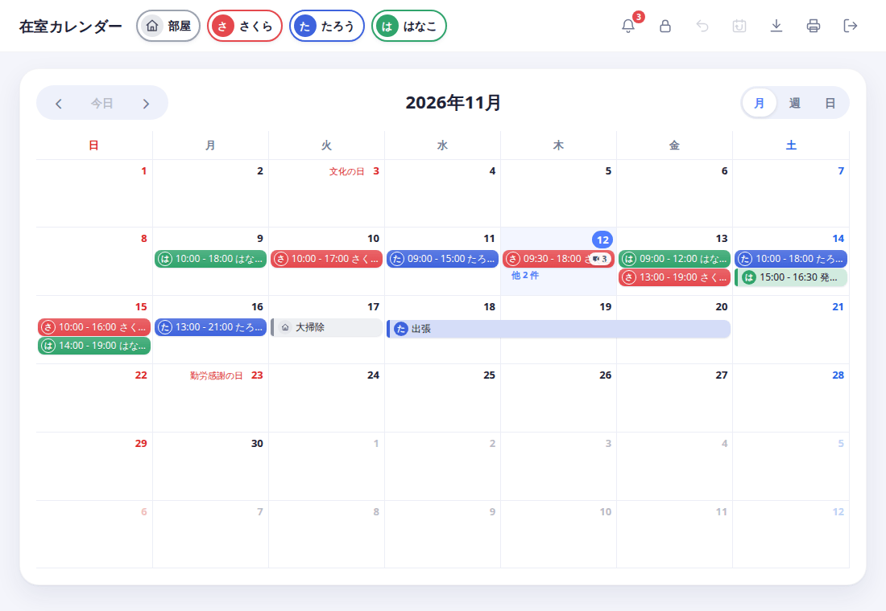

# 在室カレンダーの使い方

部屋に誰がいつ居るかを、みんなで共有するカレンダーです。
このフォルダの文書は、1つの文書が1つのテーマだけを説明します。知りたいものから開いてください。

## はじめて使う人

最初の2つを、この順で読んでください。

1. [起動して、最初の在室を入れるまで](getting-started.md)
2. [在室の使い方](calendar.md)

## 知りたいことから選ぶ

| 知りたいこと | 文書 |
| --- | --- |
| 出張や大掃除などの予定（メモ）を入れたい | [メモの使い方](memo.md) |
| 登録、ログイン、パスワードを忘れたとき、退会 | [アカウント](account.md) |
| 他の人の予定にスタンプやコメントを付けたい。通知を見たい | [反応（スタンプ・コメント）と通知](reactions.md) |
| AI やスクリプトからカレンダーを使いたい | [APIトークン](api-token.md) |
| サーバーを用意する・設定する（管理する人向け） | [サーバーの設定](setup.md) |

## ほかに

- 機能の一覧と技術的な情報は、リポジトリの [README](../README.md) にあります。
- AI に渡す API の仕様書は、サーバーの `/api/docs` から読めます（[APIトークン](api-token.md)で説明しています）。
