[docs の目次](README.md)

# アカウント

**このページでわかること**: 登録・ログイン・ログアウト・パスワードの再設定・人の編集・退会のやり方です。

ログインすると、自分の予定とメモを編集できます。ログインしなくても、見るだけならできます。

## 登録する

登録は、メールアドレスの確認、人の選択の順に進みます。

1. 右上の「ログイン」を押します。

   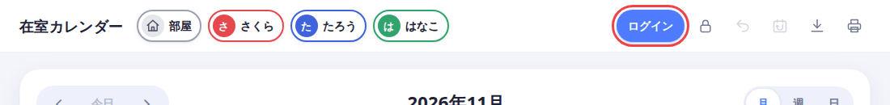

2. 「新規登録」を押します。

   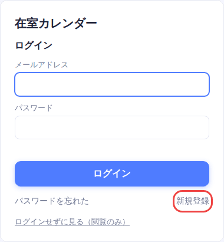

3. メールアドレスと、パスワードを2回入れます。パスワードは8文字以上です。「確認メールを送る」を押します。

   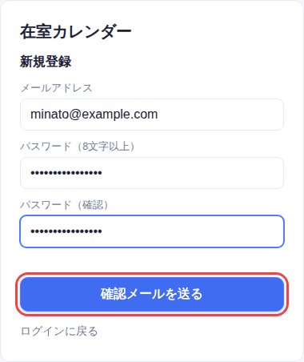

4. メールに届いた6桁のコードを入れて、「コードを確認する」を押します。

   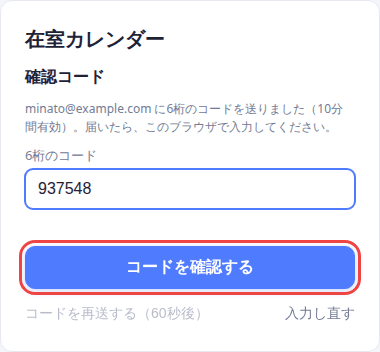

   - コードの有効期間は10分です。
   - 申し込んだブラウザで入力してください。
   - 届かないときは、「コードを再送する」を押します（60秒に1回）。迷惑メールのフォルダも見てください。

5. 「あなたの人」を決めて、「登録を完了する」を押します。

   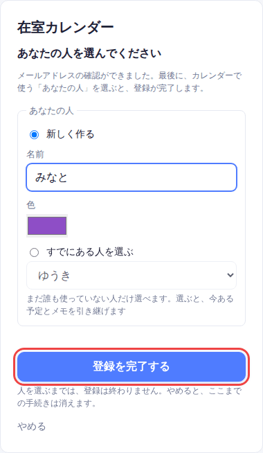

   - 新しく作るとき: 名前と色を決めます。
   - すでにある人を使うとき: 「すでにある人を選ぶ」から選びます。その人の予定とメモを引き継げます。まだ誰も使っていない人だけ選べます。

「登録を完了する」を押すまでは、登録は終わりません。途中でやめると、何も登録されません。完了すると、ログインした状態でカレンダーが開きます。

## ログインする

1. 右上の「ログイン」を押します。
2. メールアドレスとパスワードを入れて、「ログイン」を押します。

   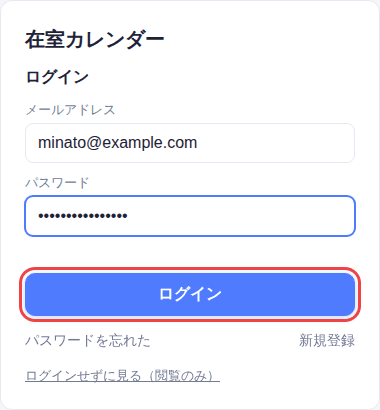

## ログアウトする

右上の、矢印のついたボタンを押します。

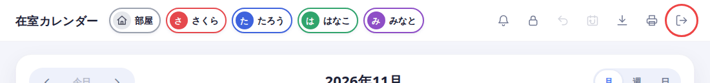

スマホでは、右上の「…」を押して、「ログアウト」を選びます。

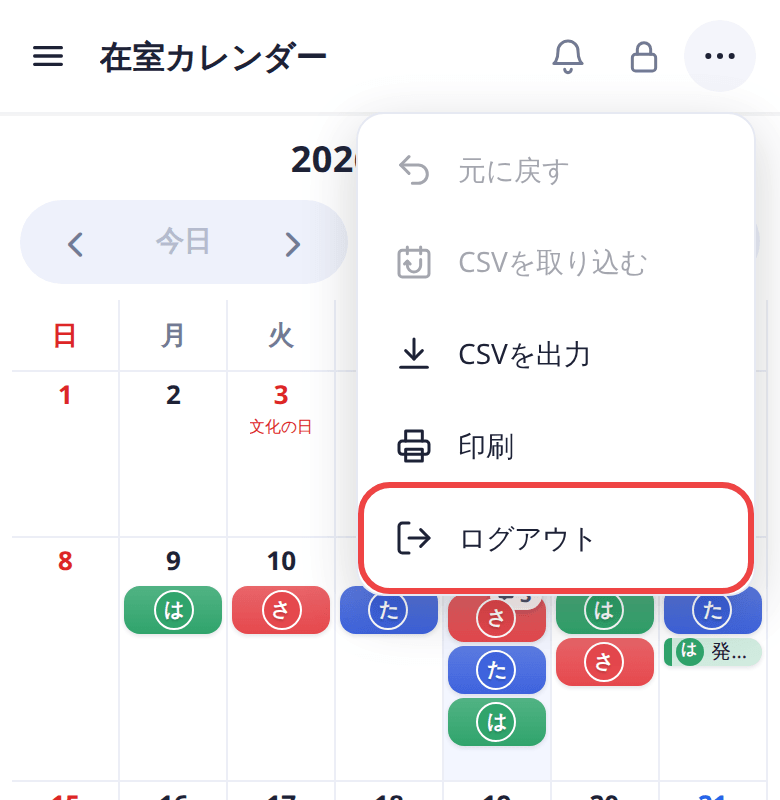

## パスワードを忘れたとき

1. ログインの画面で、「パスワードを忘れた」を押します。
2. 登録したメールアドレスを入れて、「リンクを送る」を押します。

   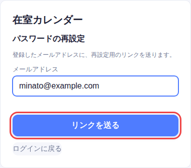

3. 届いたメールのリンクを開きます。リンクは1時間有効で、1回だけ使えます。
4. 新しいパスワードを2回入れて、「パスワードを変更する」を押します。

   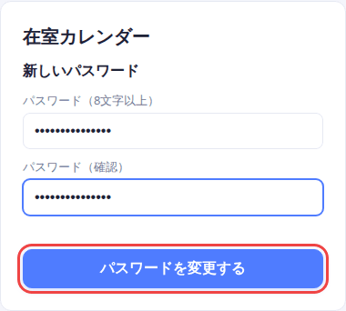

5. 新しいパスワードで、ログインし直します。

パスワードを変えると、すべての端末からログアウトされます。

## 人の名前・色・アイコンを変える

1. 右上の鍵を押して、ロックを解除します。
2. 自分の名前の横の、鉛筆を押します。

   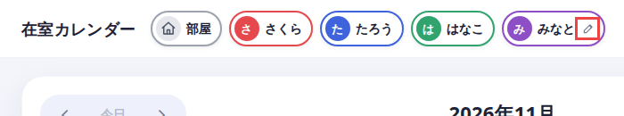

   スマホでは、左上の三本線を押して開く「表示する人」の中に、鉛筆があります。

   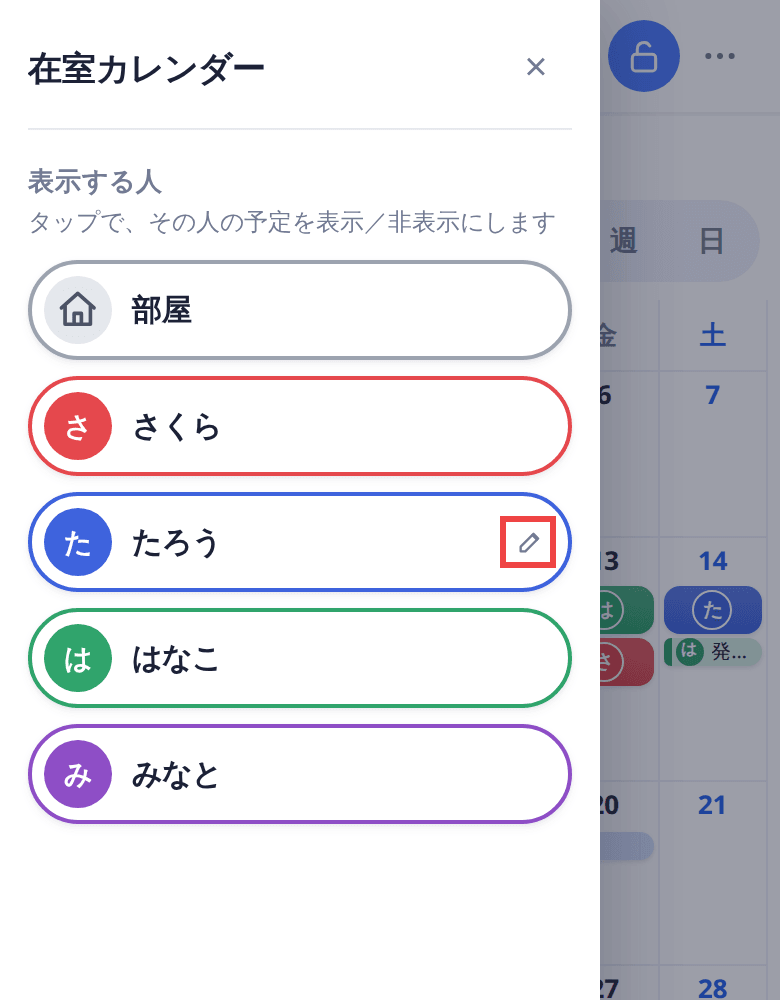

3. 「人を編集」の画面で、名前・色・画像を変えます。画像は「画像を選ぶ」で選びます。外すときは「画像を外す」を押します。
4. 「保存」を押します。

   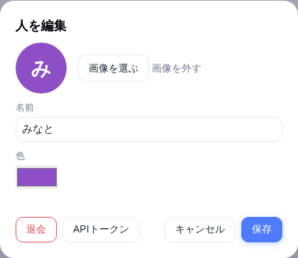

## 退会する

退会すると、アカウントと、自分の人・在室・メモがすべて消えます。**元に戻せません。**

1. 人の編集の画面で、「退会」を押します（画面の出し方は、上の「人の名前・色・アイコンを変える」と同じです）。
2. パスワードを入れて、「退会する」を押します。

   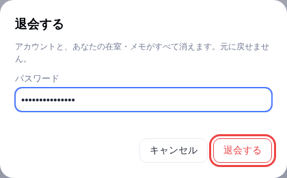

## 次に読む

[反応（スタンプ・コメント）](reactions.md)
