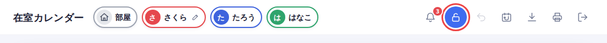
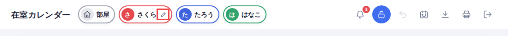
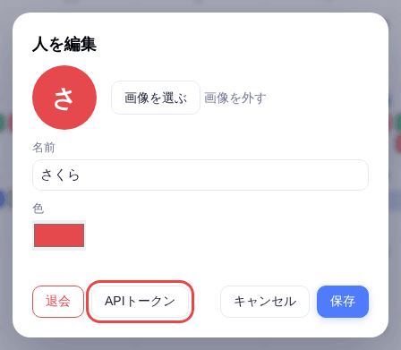
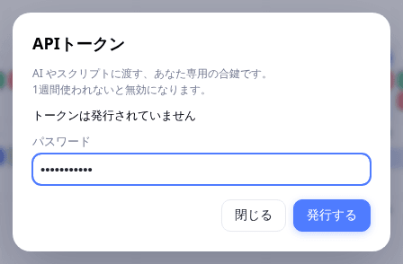
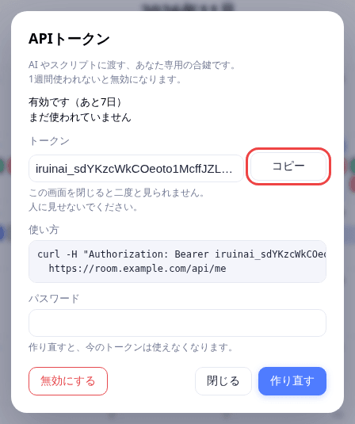
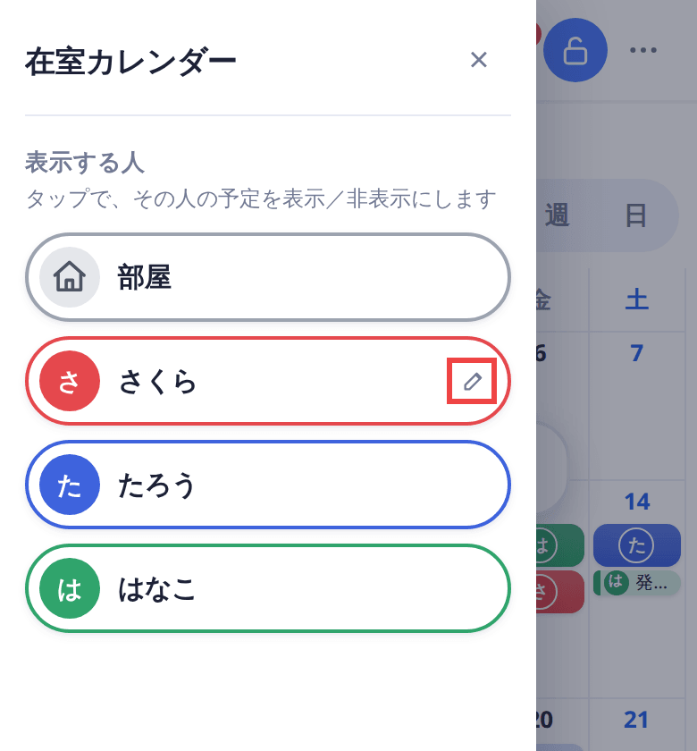
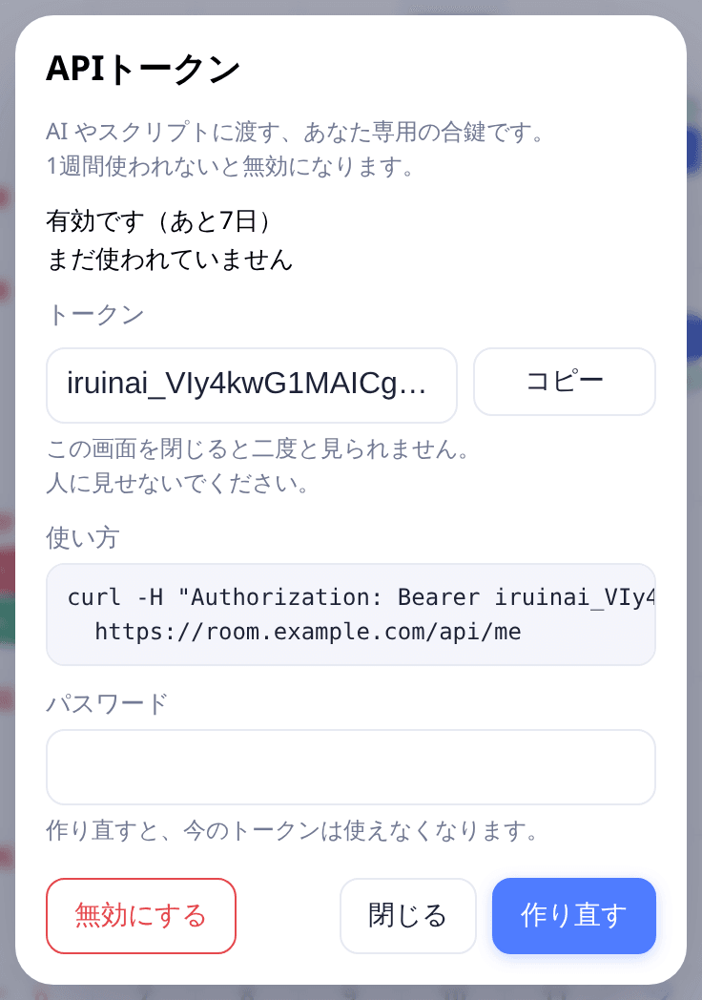
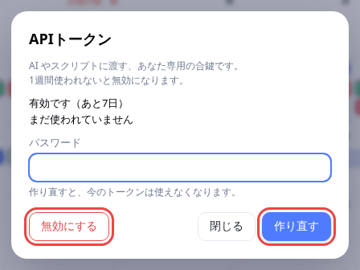

[docs の目次](README.md)

# APIトークン

**このページでわかること**: AI やスクリプトに、あなたの代わりにカレンダーを操作させるための「APIトークン」の使い方です。

APIトークンは、あなたと同じ操作ができる合鍵です。1人に1つだけ作れて、1週間使われないと自動で無効になります。

AI やスクリプトを使わない人は、このページを読まなくて大丈夫です。

## トークンを発行する

1. ログインして、画面右上のロックのボタンを押します。ロックが解除されます。

   

2. 自分の名前の横に、鉛筆のマークが出ます。押します。

   

3. 「人を編集」の画面で、「APIトークン」を押します。

   

4. 「パスワード」に、ログインのパスワードを入れます。

5. 「発行する」を押します。

   

6. 「トークン」の欄に、`iruinai_` で始まる文字が出ます。「コピー」を押して、控えておきます。

   

**トークンが見えるのは、この1回だけです。** 画面を閉じると、二度と見られません。忘れたときは、作り直します。

トークンは、人に見せないでください。持っている人は、あなたと同じ操作ができます。

### スマホで発行するとき

スマホでは、左上の三本線のボタンを押すと、名前の一覧が出ます。その中の鉛筆のマークを押します。そのあとは同じです。



スマホの画面でも、トークンは同じように出ます。



## AI に渡す

AI には、次の2つを渡します。

- 仕様書の URL: `https://<サイト>/api/docs`（`<サイト>` は、このカレンダーのアドレスです）
- さきほどのトークン

仕様書は、トークンだけで読めます。そのまま貼れる文の例です。

```
在室カレンダーを操作してください。
使い方は、次の仕様書に書いてあります。

仕様書: https://room.example.com/api/docs
トークン: <ここにトークンを貼る>

トークンは、リクエストの Authorization ヘッダーに
「Bearer <トークン>」の形で付けてください。

お願い: 明日の13:00から19:00まで、私の在室を登録してください。
```

`room.example.com` は、お使いのサイトのアドレスに、`<ここにトークンを貼る>` は、トークンに書き換えます。

## 使えるか確かめる

ターミナルで、次を実行します。`room.example.com` と、トークンの部分は書き換えます。

```
curl -H "Authorization: Bearer iruinai_..." https://room.example.com/api/me
```

こう返ってくれば、使えます。

```
{"user":{"id":1,"email":"you@example.com","person_id":1}}
```

`{"user":null}` が返ったときは、トークンが違うか、期限切れです。

## 作り直す・無効にする

トークンの画面を開き直すと、状態が出ます。

1. 名前の横の鉛筆から、もう一度「APIトークン」を開きます。
2. 状態を見ます。「有効です（あと7日）」と、最後に使った時刻が出ます。
3. 作り直すときは、パスワードを入れて「作り直す」を押します。古いトークンは、すぐ使えなくなります。
4. 使うのをやめるときは、「無効にする」を押します。パスワードは要りません。



次のときも、トークンは無効になります。

- 1週間使われなかったとき（使うたびに、1週間に延びます）
- パスワードを再設定したとき、退会したとき

## 発行すると、メールが届きます

トークンを発行したときと、作り直したときに、アカウントのメールアドレスへお知らせが届きます。身に覚えのない発行に気づくためのものです。

> 件名: 【在室カレンダー】APIトークンが発行されました
>
> 在室カレンダーで、あなたのアカウントのAPIトークンが発行されました（作り直した場合、古いトークンは使えなくなりました）。
>
> トークンは、最後に使ってから1週間使われないと、自動的に無効になります。
>
> 心当たりがない場合は、パスワードを変更してください（トークンも無効になります）。

- メールに、トークンは書かれていません。
- 無効にしたときは、届きません。
- 続けて作り直したときは、1分に1通までです。

## トークンでできないこと

トークンでできるのは、あなたと同じ、予定やメモの見る・足す・直す・消すです。

次の操作は、トークンではできません。「この操作は、トークンではできません」と出て、`403` になります。

- ログイン、登録、パスワードの操作
- 退会
- トークン自身の発行と無効化

他の人の予定やメモを直すことも、できません。

## 次に読む

[サーバーの設定（管理する人向け）](setup.md)
