[docs の目次](README.md)

# 在室の使い方

**このページでわかること**: 在室の追加（何日分かまとめて入れる方法も）、直す・動かす、削除、元に戻す、表示の切り替え、人ごとの表示／非表示です。

在室を足したり直したりするには、ログインしている必要があります。まだの人は、先に[起動して、最初の在室を入れるまで](getting-started.md)を読んでください。

## 編集のロックを解除する

1. 右上の鍵のボタンを押して、ロックを解除します。

   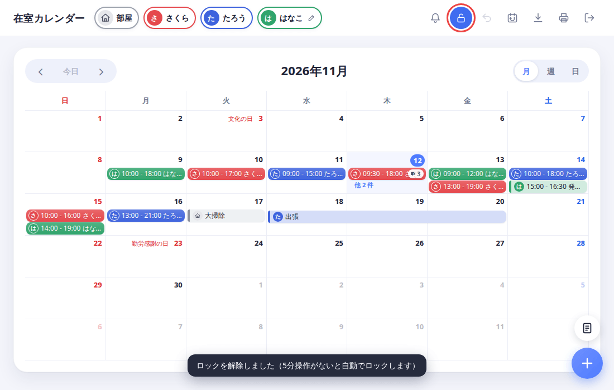

   - ページを開いたときは、間違って変更しないよう、必ずロックされています。
   - ロックを解除して5分間なにも操作しないと、自動でロックに戻ります。
   - ロック中でも、在室を押すと内容は見られます。

## 在室を1日分入れる

1. 在室を入れたい日の、日付のマスをクリックします。

   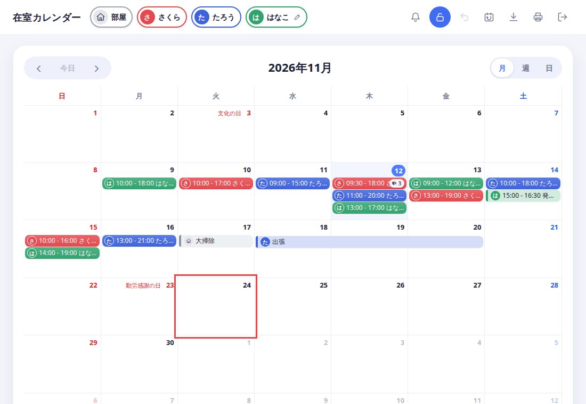

2. 「在室を追加」の画面が開きます。「開始」と「終了」の時間を直して、「保存」を押します。一言メモを残したいときは、「メモ」に書きます。

   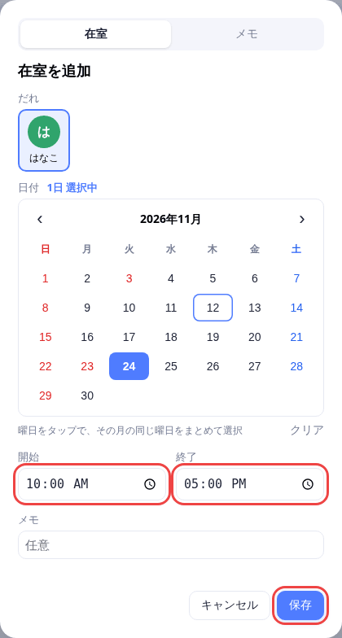

スマホの月表示では、日付をタップすると、その日の表示に切り替わります。在室を入れるときは、右下の「＋」ボタンを押します。

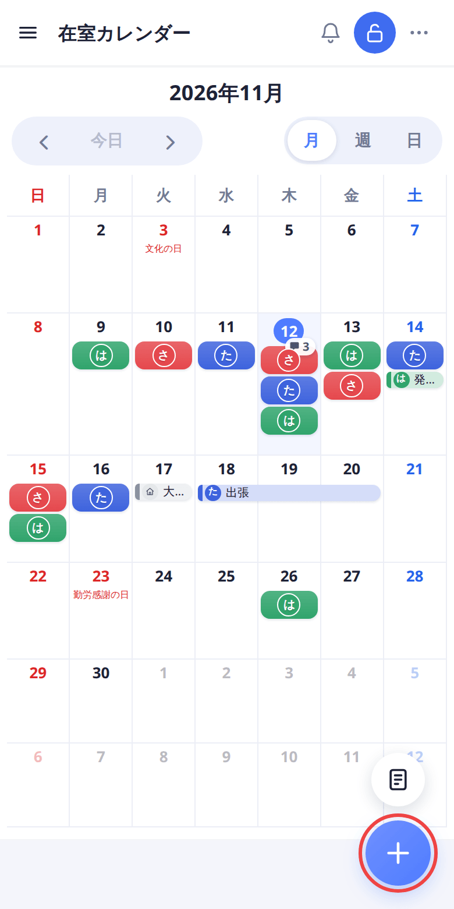

PC でも、「＋」ボタンから追加できます。「＋」は、表示している月に今日があれば今日の日付で、画面が開きます。

## 同じ時間を何日かまとめて入れる

「在室を追加」の画面にある小さいカレンダーを使います。選んだ日すべてに、同じ時間の在室が入ります。

### 日付を1つずつタップする

1. 入れたい日をタップします。もう一度タップすると、選びを外せます。

   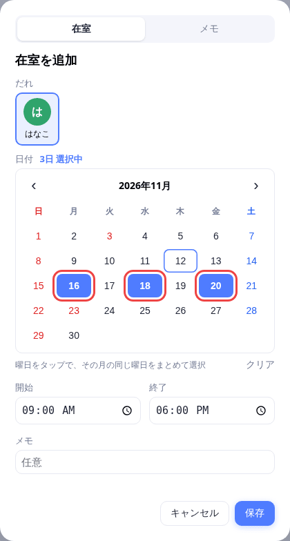

### 曜日をタップする

1. 曜日の文字（日・月・火…）をタップします。その月の同じ曜日が、まとめて選ばれます。

   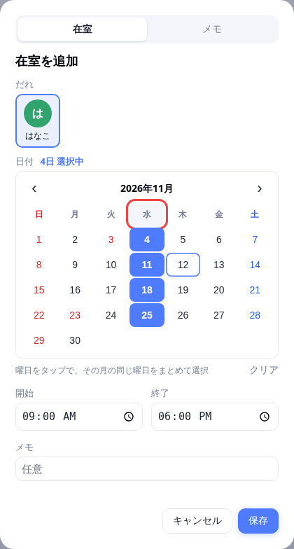

   - もう一度タップすると、その曜日の選びを外せます。
   - 「クリア」を押すと、選びをすべて外せます。

### PC の月表示でドラッグする

1. 月表示で、はじめの日から終わりの日まで、マウスをドラッグします。

   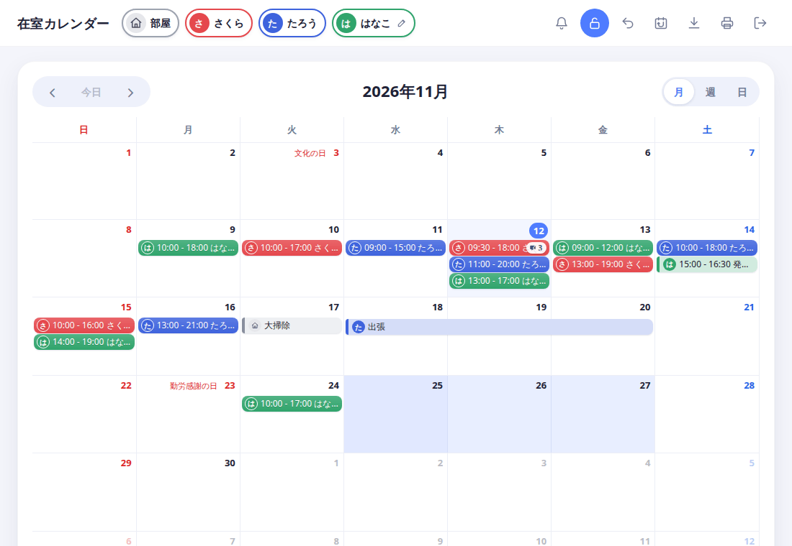

   指を離すと「在室を追加」の画面が開き、ドラッグした日が選ばれています。

どの方法でも、あとは時間を決めて「保存」を押します。

## 月・週・日の表示を切り替える

1. 右上の「月」「週」「日」を押します。

   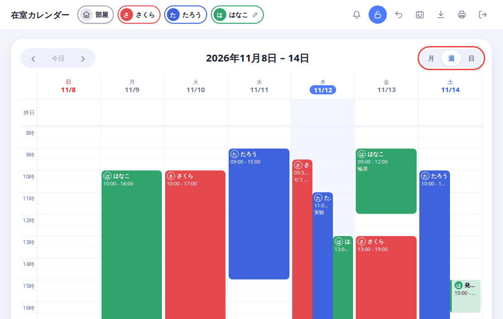

   週と日の表示は、1日を時間の目盛りで見られます。この表示は、次の「動かす」「長さを変える」に使います。

## 在室を直す・動かす

自分の在室だけ、直せます。他の人の在室は、見るだけです。

### 画面を開いて直す

1. 自分の在室を押します。「在室を編集」の画面で、日付・時間・メモを直して、「保存」を押します。

   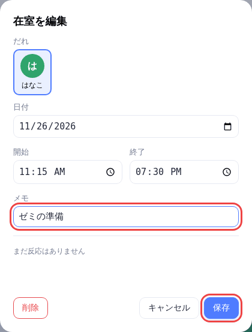

### ドラッグで動かす

1. 週か日の表示で、在室をつかんで、動かしたい日・時間までドラッグします。

   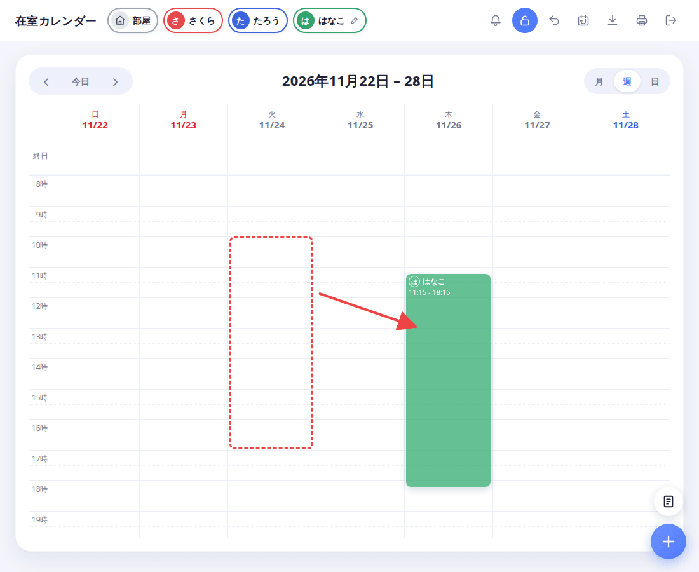

### ドラッグで長さを変える

1. 週か日の表示で、在室の下の端をつかんで、上下にドラッグします。

   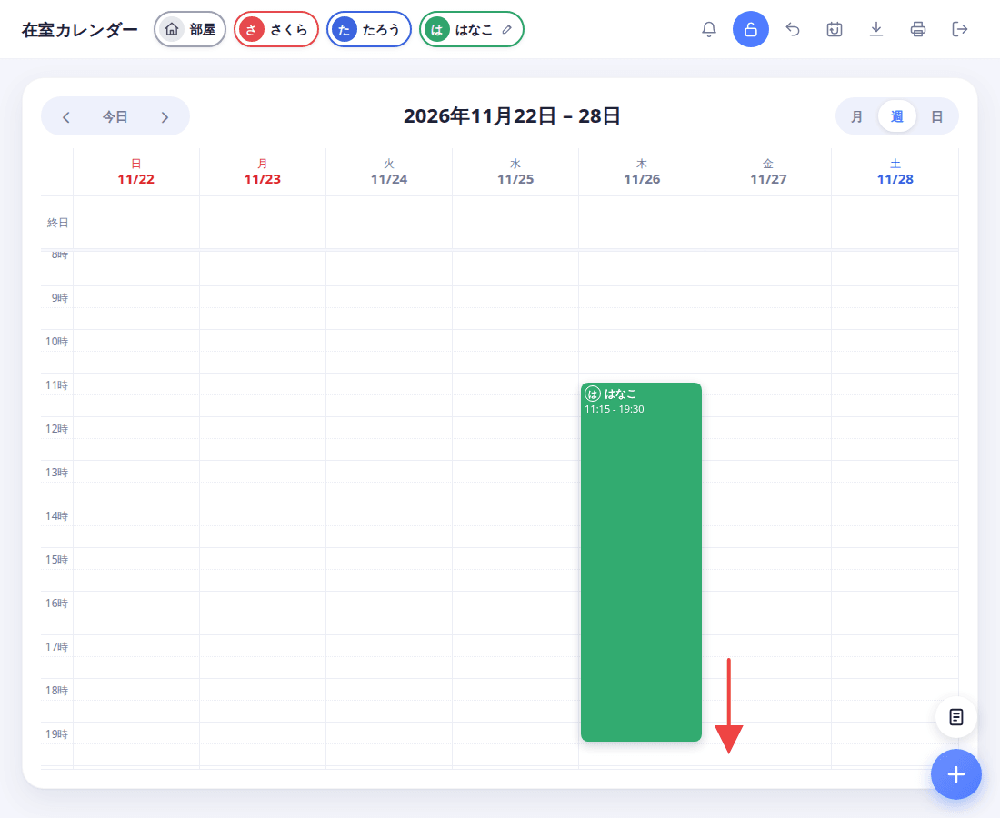

## 在室を削除する

1. 自分の在室を押して、「削除」を押します。「この在室を削除しますか？」と聞かれるので、OK を押します。

   

## 元に戻す

追加・変更・移動・削除をした直後は、画面の下に「元に戻す」が出ます。

1. 「元に戻す」を押します。

   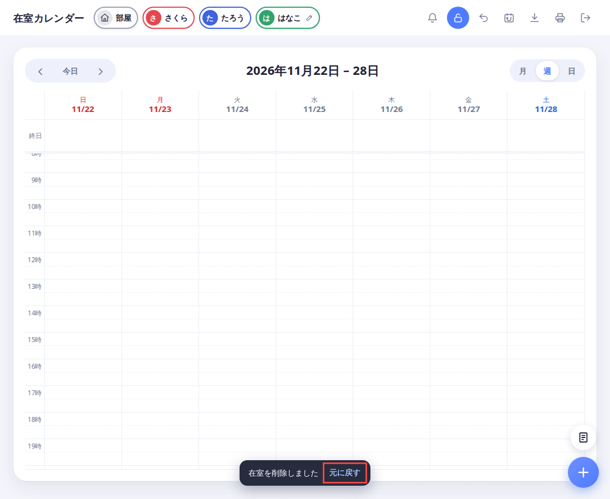

   - 「元に戻す」は、数秒で消えます。そのあとでも、右上の戻る矢印のボタンか、キーボードの Ctrl+Z（Mac は ⌘+Z）で、直前の操作から順に戻せます。スマホでは、戻るボタンは右上の「…」の中にあります。
   - 戻せるのは、この端末でした操作だけです。ページを開き直すと、戻せなくなります。

## 見たい人だけ表示する

カレンダーには、全員の在室が出ます。見たい人だけにしぼれます。

1. 上にある人の名前（色のついた枠）を押します。その人の在室が消えて、名前が薄くなります。もう一度押すと、また出ます。

   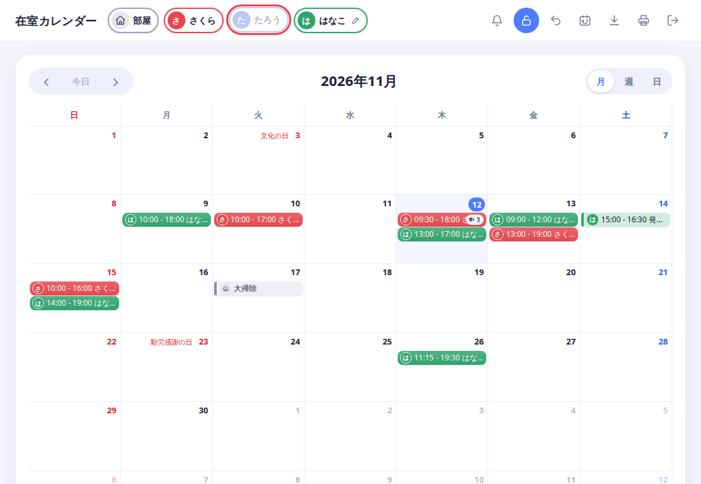

2. スマホでは、左上の三本線のボタンを押すと、人の一覧が開きます。そこで名前をタップします。

   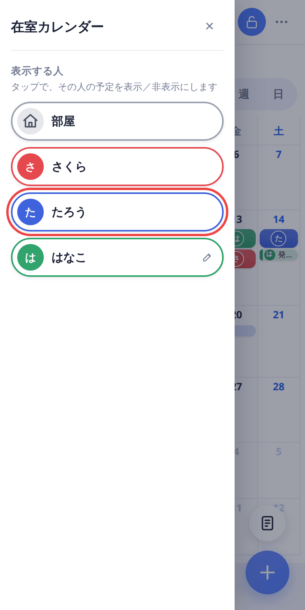

自分の画面の見え方が変わるだけです。他の人の画面や、データは変わりません。ページを開き直すと、全員が表示に戻ります。

## 次に読む

[メモの使い方](memo.md)
