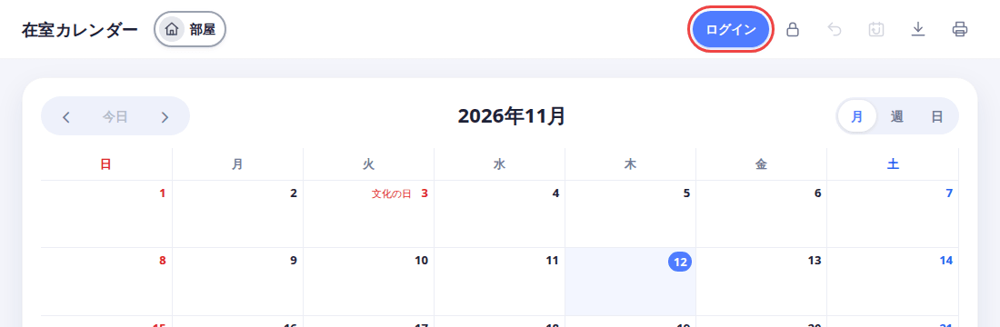
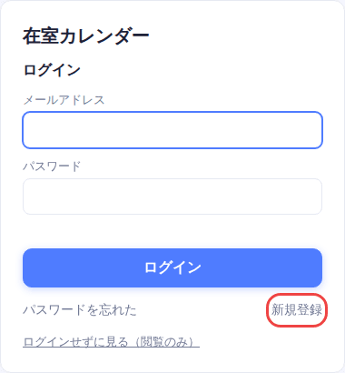
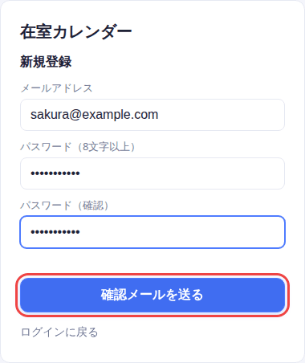
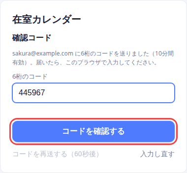
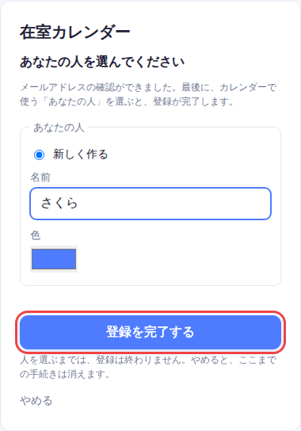
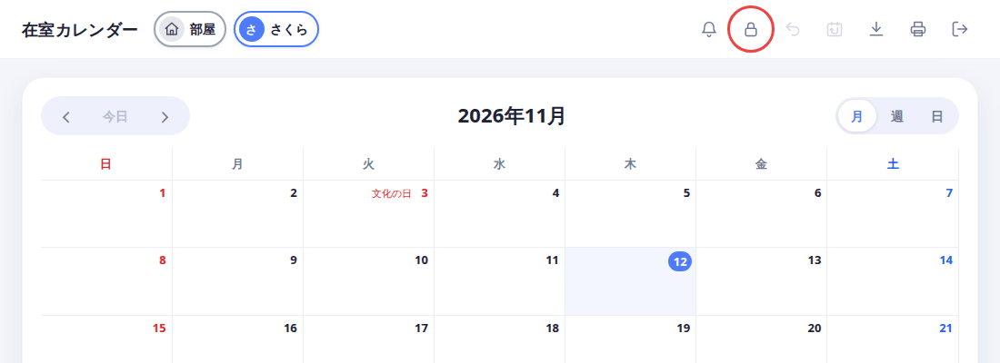
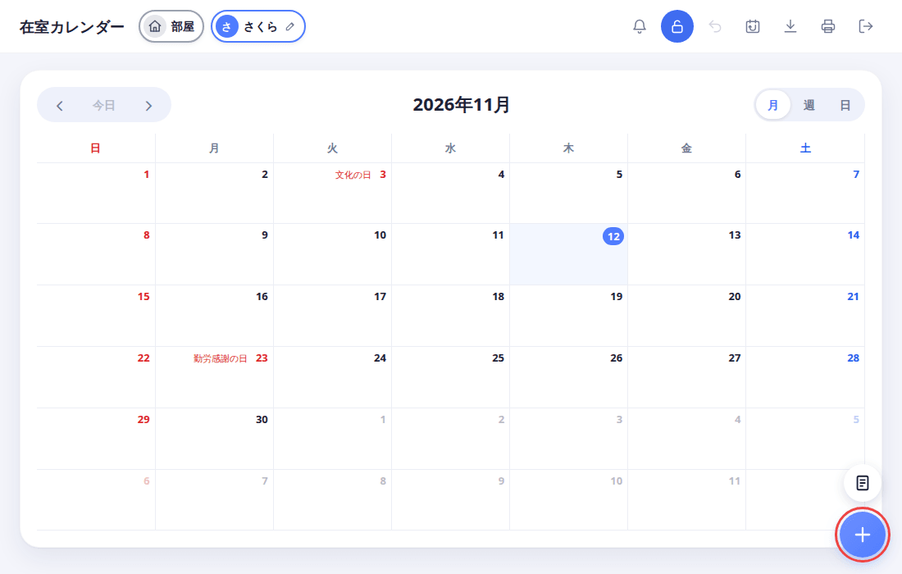
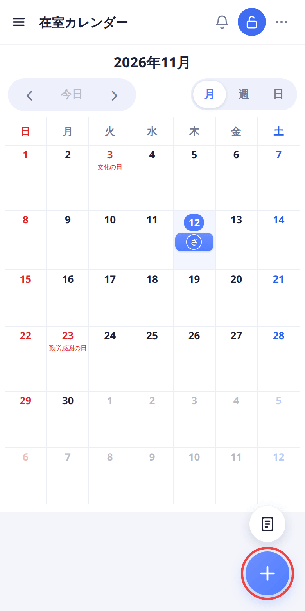
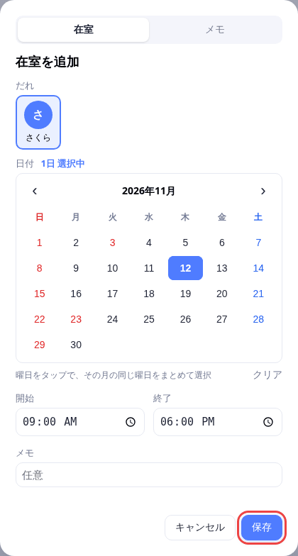
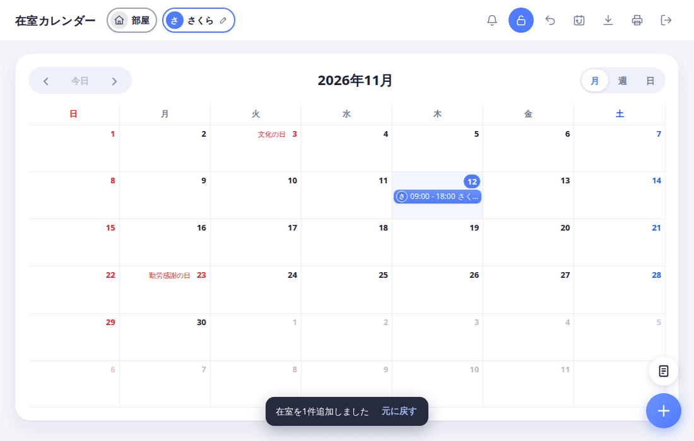

[docs の目次](README.md)

# 起動して、最初の在室を入れるまで

**このページでわかること**: サーバーを起動し、登録して、はじめての在室を1つ入れるまでの手順です。

在室とは、「この日の何時から何時まで、部屋にいます」という予定のことです。

## 1. サーバーを起動する

サーバーを動かすパソコンで、次の2行を実行します。Node.js 22.13 以降が必要です。

```sh
npm install
npm start
```

## 2. ブラウザで開く

1. ブラウザで `http://localhost:3000` を開きます。右上の「ログイン」を押します。

   

## 3. 登録する

1. ログイン画面の右下にある「新規登録」を押します。

   

2. メールアドレスと、8文字以上のパスワードを入れます。パスワードは確認のため2回入れます。入れたら「確認メールを送る」を押します。

   

3. メールに6桁のコードが届きます。コードを入れて、「コードを確認する」を押します。

   

   - コードは10分間使えます。
   - 申し込んだブラウザで入力してください。
   - 自分でサーバーを動かしていて、メールの設定をしていないときは、メールは送られません。コードは、サーバーを起動した画面（コンソール）に出ます。

4. 「あなたの人」を決めます。「新しく作る」を選んだまま、名前を入れ、好きな色を選びます。入れたら「登録を完了する」を押します。

   

   - 「人」は、カレンダーでのあなたの名前と色です。
   - 部屋にまだ誰も使っていない人がいるときは、「すでにある人を選ぶ」も選べます。
   - 「登録を完了する」を押すまでは、登録は終わりません。

## 4. 最初の在室を入れる

登録が終わると、カレンダーが開きます。

1. 右上の鍵のボタンを押して、ロックを解除します。

   

   ページを開いたときは、間違って変更しないよう、必ずロックされています。ロック中は「＋」ボタンが出ません。

2. 右下に「＋」ボタンが出ます。押します。

   

   スマホでも、右下の同じ場所にあります。

   

3. 「在室を追加」の画面が開きます。今日の日付が選ばれ、時間は 9:00 から 18:00 になっています。このまま「保存」を押します。

   

4. カレンダーの今日のところに、あなたの色で在室が出ます。これで完了です。

   

## 次に読む

[在室の使い方](calendar.md)
