[docs の目次](README.md)

# メモの使い方

**このページでわかること**: 出張・休み・大掃除などの「メモ」を、追加・編集・削除する方法と、部屋のメモの表示／非表示です。

メモは、在室とは別に、カレンダーへ書き込む目印です。メモを書くにはログインが必要です。

## 終日のメモを追加する

1. 右上の鍵のボタンを押して、ロックを解除します。ロック中は編集できません。

   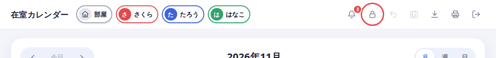

2. 右下の、書類のマークの小さいボタン（メモを追加）を押します。下の大きい「＋」は在室の追加です。

   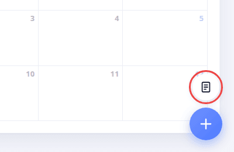

3. 「だれ／部屋」で、メモを付ける先を選びます。

   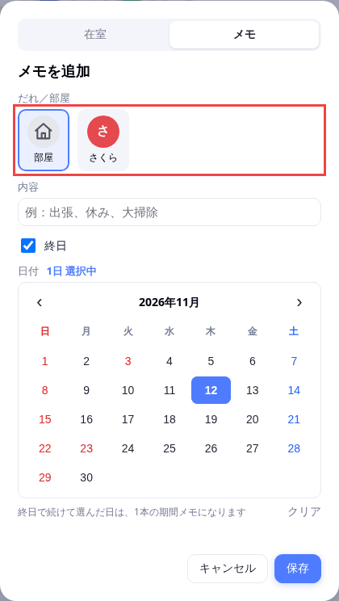

   - **自分の名前**: 自分のメモです。自分の色の、薄い色で表示されます。
   - **部屋**: 部屋全体のメモです（例: 大掃除、ゼミ）。グレーで表示されます。ログインしていれば、誰でも編集できます。

4. 「内容」に書き、「終日」にチェックを付けたまま、日付をタップして選びます。

   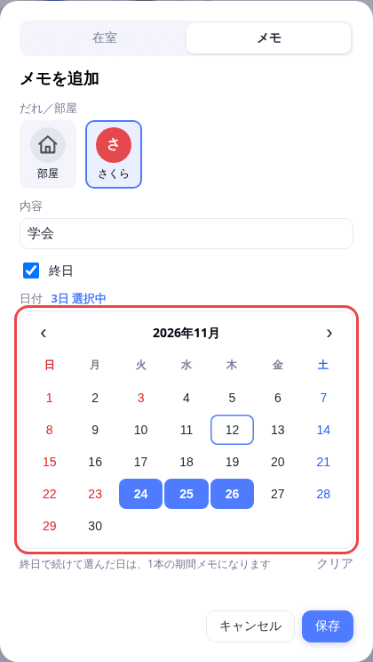

   続けて選んだ日は、1本のバーになります。離れた日を選ぶと、別々のメモになります。

5. 「保存」を押します。カレンダーにメモが出ます。

   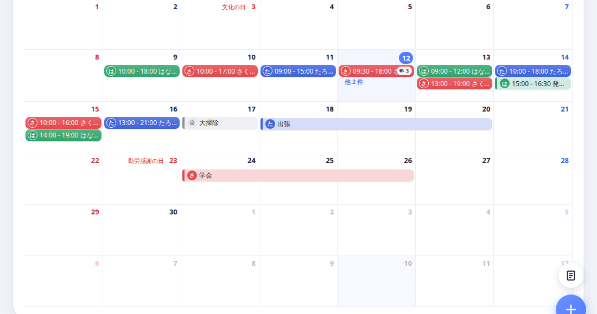

## 時間指定のメモを追加する

「会議は15時から」のように、時間のあるメモです。

1. メモを追加する画面で、「終日」のチェックを外します。

   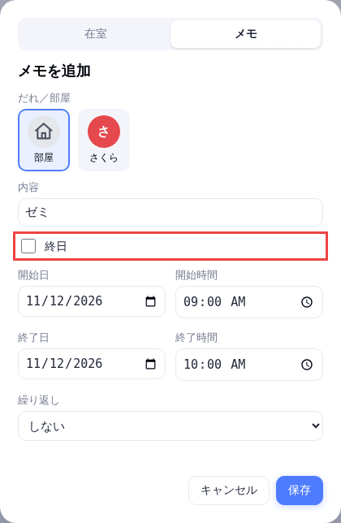

2. 開始日・開始時間・終了日・終了時間を入れます。日をまたぐメモも、1件にできます。
3. 「保存」を押します。

お使いのブラウザによっては、時間が「03:00 PM」のように表示されます。15:00 のことです。

## 繰り返すメモを追加する

繰り返しは、時間指定のメモを新しく追加するときだけ使えます。

1. 「繰り返し」から、次のどれかを選びます。
   - 毎日
   - 平日（月〜金）
   - 毎週
   - 隔週
   - 毎月
2. 「いつまで」の日付を決めます。はじめは、開始日の1か月後です。

   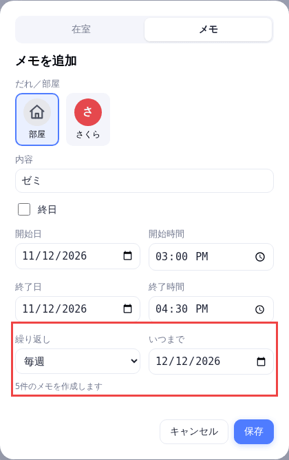

   下に「5件のメモを作成します」のように、作られる件数が出ます。上限は100件です。

3. 「保存」を押します。

繰り返しで作ったメモは、1件ずつ別のメモです。あとから、1件だけ直したり消したりできます。

## メモを編集・削除する

1. ロックを解除して、カレンダーのメモを押します。「メモを編集」の画面が開きます。
2. 内容や日付を直して、「保存」を押します。

   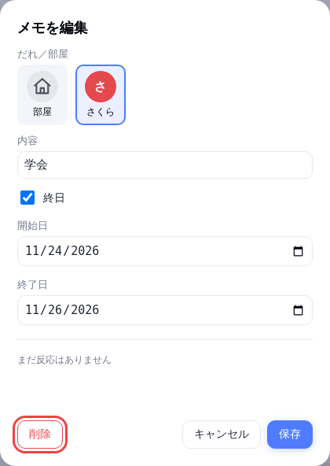

3. 消すときは、「削除」を押し、確認で OK を選びます。消した直後は、画面に出る「元に戻す」で戻せます。

編集できるのは、自分のメモと部屋のメモです。他の人のメモは、見るだけです。

## 部屋のメモを隠す・出す

1. 上部の「部屋」を押します。「部屋」が薄くなり、部屋のメモが消えます。

   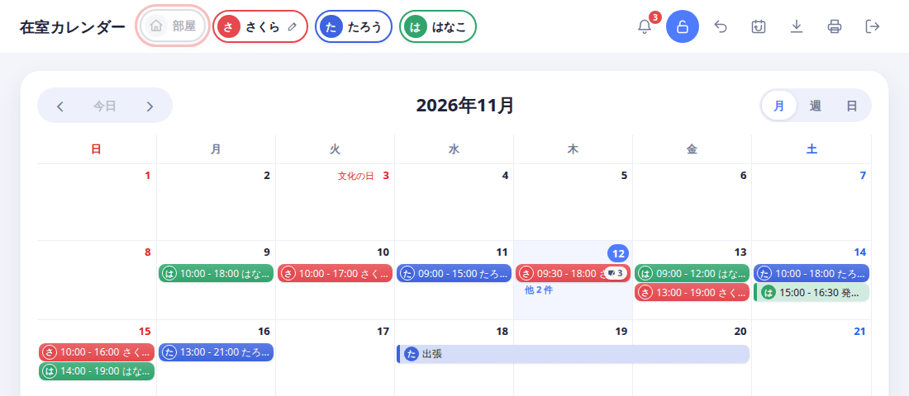

2. もう一度押すと、部屋のメモが出ます。

ページを開き直すと、元の表示（部屋のメモが出た状態）に戻ります。

## スマホで使うとき

使い方は同じです。メモの追加画面は、縦に長くなります。

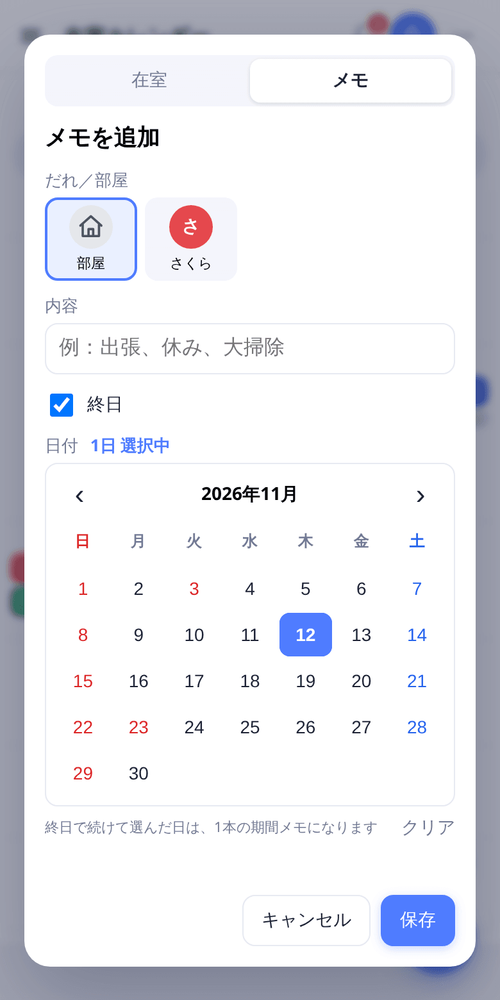

「部屋」は、左上の三本線を押すと開く「表示する人」の中にあります。

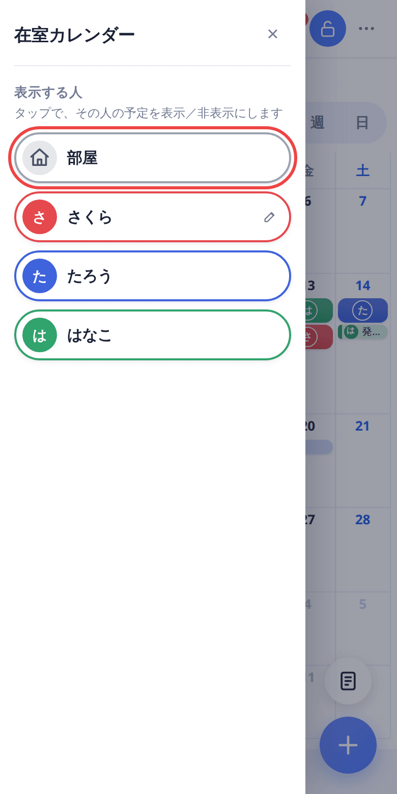

## 次に読む

[アカウント（登録・ログイン・退会）](account.md)
