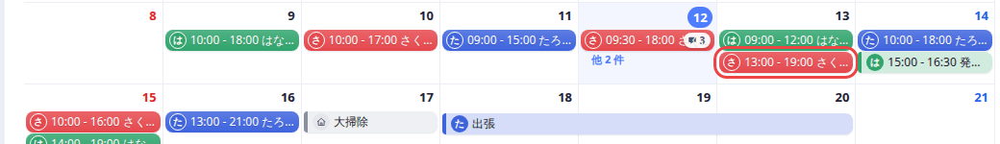
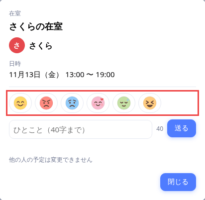
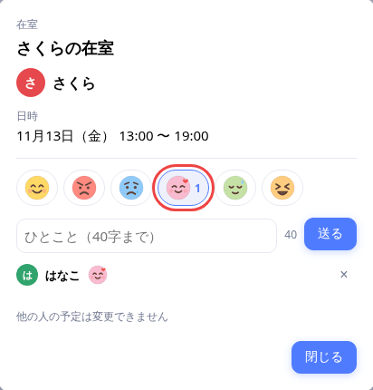
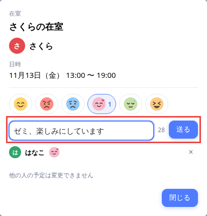
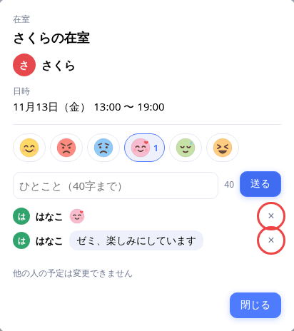
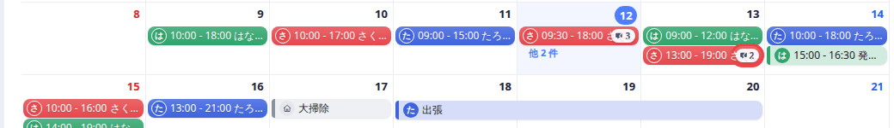
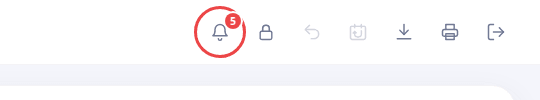
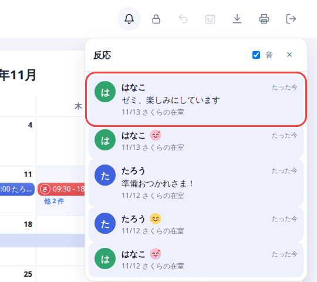
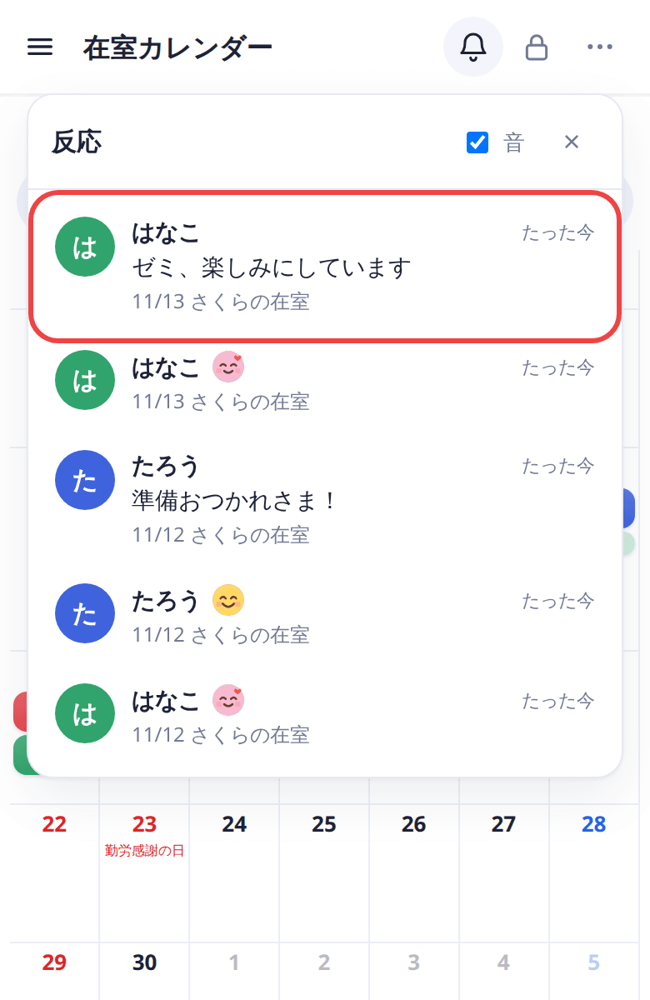
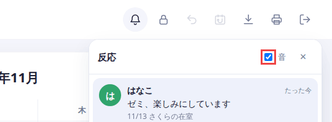

[docs の目次](README.md)

# 反応（スタンプ・コメント）と通知

**このページでわかること**: 他の人の予定にスタンプやコメントを付ける方法と、自分の予定に付いた反応を知る方法です。

反応を付けるには、ログインが必要です。ロックを解除する必要はありません。

## スタンプを付ける

1. カレンダーで、他の人の予定かメモを押します。

   

2. 開いた画面の、顔のスタンプが並んだ欄が「反応」欄です。スタンプは6種類です（いいね・おこ・かなしい・ありがとう・おつかれ・わらい）。

   

3. 付けたいスタンプを押します。押したスタンプには色が付き、下に自分の名前といっしょに出ます。

   

4. 取り消すときは、同じスタンプをもう一度押します。

同じスタンプは、1つの予定に1回だけ付けられます。

## コメントを書く

1. 「ひとこと」の欄に、コメントを入力します。40字までです。右の数字は、あと何字書けるかを表します。

   

2. 「送る」を押します。コメントが、下の一覧に出ます。

3. 自分が付けた反応は、右の「×」で消せます。

   

覚えておくこと:

- コメントは、1つの予定に5件までです。書いたあとの編集はできません。
- 消せるのは、反応を付けた本人だけです。予定の持ち主でも、他の人の反応は消せません。
- 自分の予定やメモには、反応を付けられません。付いた反応を見るだけです。

## 反応の数を見る

反応が付いた予定には、吹き出しのマークと数が出ます。数は、スタンプとコメントの合計です。

## 自分の予定に付いた反応を知る

1. 右上のベルを見ます。まだ見ていない反応があると、数が出ます。

   

2. ベルを押すと、反応の一覧が開きます。新しい順に、50件まで出ます。開くと、すべて既読になります。

3. 一覧の行を押すと、その予定の日に移動します。

   

スマホでも、ベルは右上にあります。

## 音を切る

新しい反応が付くと、予定のところに吹き出しが出て、「ぽん」と音が鳴ります。他の人の反応は、最長で約30秒遅れて届きます。

音が不要なときは、一覧の上の「音」のチェックを外します。この設定は、その端末に残ります。

## 次に読む

[APIトークン](api-token.md)
