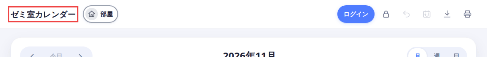
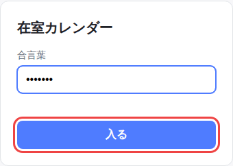
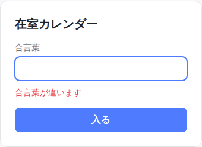
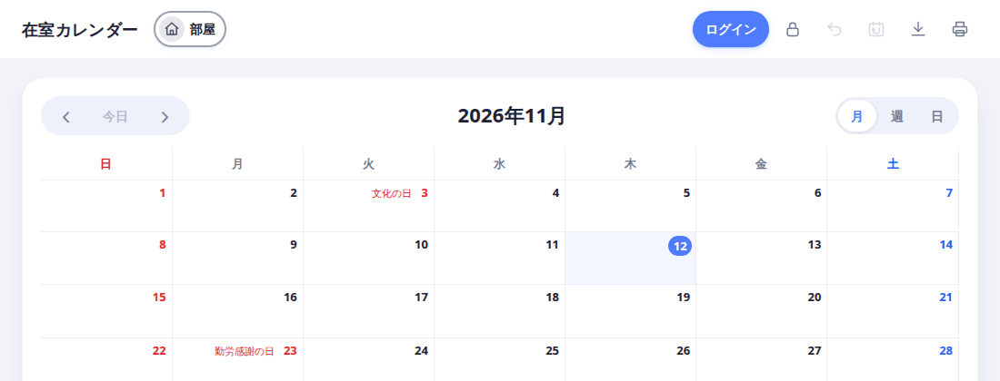

[docs の目次](README.md)

# サーバーの設定（管理する人向け）

**このページでわかること**: サーバーを動かす人が、`.env` で設定する方法、合言葉、データの置き場所、バックアップのやり方です。

サーバーの起動は、`npm install` のあと `npm start` です（Node.js 22.13 以降）。設定をしなくても動きます。

## `.env` を作る

1. `.env.example` を、同じフォルダ（`server.js` があるフォルダ）に `.env` という名前でコピーします。
2. 使う項目の先頭の `#` を消して、値を書きます。

最小の例です。

```
PORT=3000
ROOM_PASSWORD=himitsu
```

3. サーバーを起動し直します。`.env` は、起動するときに読まれます。

`.env` に書かない項目は、既定の値で動きます。`.env` は Git に入りません。

## 項目をひとつずつ

必要なものだけ、足してください。

### `PORT`（ポート番号）

ブラウザで開くときのポート番号です。既定は `3000` です。

### `ROOM_PASSWORD`（合言葉）

書くと、開くときに合言葉が必要になります。くわしくは、下の「合言葉」を見てください。

### `APP_TITLE`（アプリの名前）

画面の左上の見出しなどに出る名前です。既定は「在室カレンダー」です。

```
APP_TITLE=ゼミ室カレンダー
```



次の場所にも、この名前が使われます。

- ブラウザのタブの名前
- 合言葉・ログインの画面
- 登録やパスワード再設定のメールの件名と本文

40文字までです。共有したときに出る画像（`public/iruinai-ogp.png`）の文字は変わりません。変えたいときは、画像を差し替えてください。

### `DATA_DIR`（データの置き場所）

データベースと画像を置くフォルダです。既定は、アプリのフォルダの中の `data` です。場所を変えるときは、絶対パスで書くと確実です。

```
DATA_DIR=/srv/room-calendar
```

### メールの送信（`SMTP_*`・`MAIL_FROM`・`PUBLIC_URL`）

登録の確認コードと、パスワード再設定のリンクは、メールで届きます。メールを送るには、SMTP サーバーの設定が要ります。

```
SMTP_HOST=smtp.example.com
SMTP_PORT=587
SMTP_USER=noreply@example.com
SMTP_PASS=（パスワード）
MAIL_FROM=在室カレンダー <noreply@example.com>
PUBLIC_URL=https://room.example.com
```

- `SMTP_PORT` の既定は `587` です。ポート 465 で TLS につなぐときは、`SMTP_SECURE=true` も書きます。
- `MAIL_FROM` を書かないときは、`SMTP_USER` が送信元になります。
- `PUBLIC_URL` は、利用者が開く URL です。メールのリンクのもとになります。`SMTP_HOST` を書くときは、必ず書いてください。書かないと、パスワード再設定のメールは送られません。
- `PUBLIC_URL` を `https://` で始めると、ログインの Cookie に `Secure` が付きます。そのため、`http://` で開くとログインできなくなります。

`SMTP_HOST` を書かないと、メールは送られません。確認コードとリセットのリンクは、サーバーのコンソールに出ます。利用者が自分で登録するには、メールの設定が必要です。

メールの送りすぎを防ぐ上限が、既定で入っています。ふつうは変えなくて大丈夫です。変えたいときは、README の「設定（環境変数）」を見てください。

## 合言葉

`ROOM_PASSWORD` を書いて起動すると、利用者が最初に見るのは、カレンダーではなく合言葉の画面です。

1. 利用者が、サーバーの URL を開きます。合言葉の画面が出ます。
2. 合言葉を入れて、「入る」を押します。

   

3. 合言葉が違うと、「合言葉が違います」と出ます。

   

4. 合っていると、カレンダーが開きます。この状態では、見るだけです。編集するには、右上の「ログイン」から、自分のアカウントでログインします。

   

知っておくこと:

- 合言葉は、全員が同じものを使います。人ごとのものではありません。
- 一度入ると、そのブラウザでは1年間、入力が要りません。
- 合言葉を変えて、サーバーを再起動すると、全員がもう一度入力します。
- 同じ IP アドレスから5回続けて間違えると、1分間は入力できません。
- 通信は暗号化されません（HTTP）。インターネットに公開するときは、HTTPS の下で動かしてください。

## データの置き場所

データは、`data` フォルダ（`DATA_DIR` を書いたときは、そのフォルダ）に入ります。

- `app.db`: データベース。予定・メモ・人・アカウントがすべて入っています。
- `uploads/`: 人のアイコン画像。

## バックアップ

`data` フォルダを、フォルダごとコピーします。サーバーを止めてからコピーすると、確実です。

戻すときは、サーバーを止めて、コピーした `data` フォルダを元の場所に置きます。

## 次に読む

[目次に戻る](README.md)
